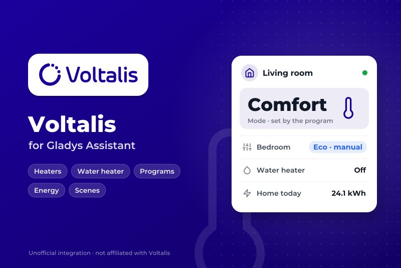
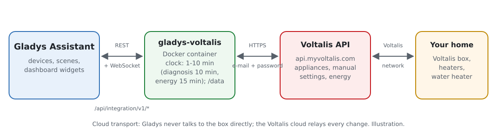
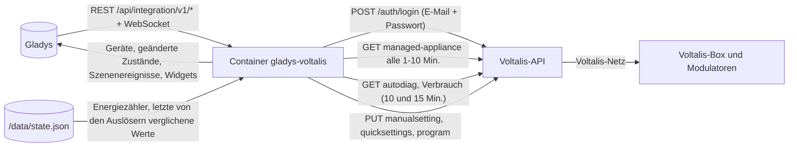
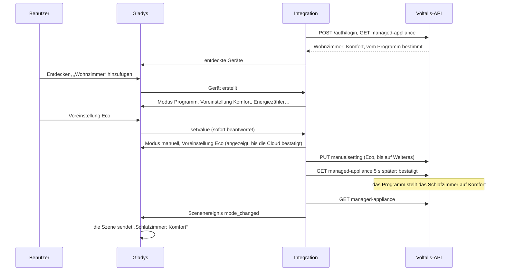
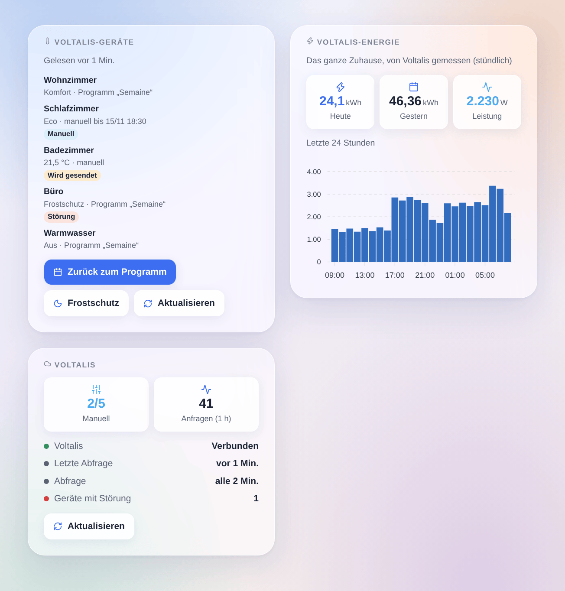

# Gladys Voltalis

[English](README.md) · [Français](README.fr.md) · **Deutsch** · [Español](README.es.md)

[](LICENSE)
[](https://github.com/William-De71/gladys-voltalis/releases)
[](https://github.com/William-De71/gladys-voltalis/actions/workflows/release.yml)
[](https://gladysassistant.com)



Externe [Gladys Assistant](https://gladysassistant.com)-Integration für die **Voltalis**-Box: ein Gerät je Verbraucher (Heizgeräte am Pilotdraht, Warmwasserbereiter, weitere Lasten) mit Modus, Voreinstellung, Solltemperatur und Energiezähler, und ein Gerät für das Zuhause mit Leistung und Energie. Sie meldet sich mit Ihrem MyVoltalis-Konto an, ergänzt Szenenauslöser und -aktionen sowie Widgets für die Geräte und die Energie der letzten 24 Stunden.

Benutzerdokumentation: [English](docs/en.md) · [Français](docs/fr.md) · [Deutsch](docs/de.md) · [Español](docs/es.md).

Keine Verbindung zu Voltalis. Voltalis veröffentlicht **keine Dokumentation** des Dienstes hinter seiner App: Die Anfragen sind die der Community-Integrationen für Home Assistant ([voltalis-homeassistant](https://github.com/ppaglier/voltalis-homeassistant), [ha-voltalis](https://github.com/jdelahayes/ha-voltalis)) und können sich ohne Vorankündigung ändern. **Noch nicht mit einer echten Voltalis-Box getestet**: Bitte melden Sie, was funktioniert und was nicht.

## Funktionen

- **Ein Gerät je Verbraucher**: Modus (aus, manuell, Programm), Voreinstellung (Frostschutz, Eco, Komfort) für die Heizgeräte, Solltemperatur (7 bis 30 °C in halben Grad), wenn der Verbraucher eine annimmt, und ein **Energiezähler** für das Energie-Dashboard von Gladys.
- **Ein Gerät für das Zuhause**: aktuelle Leistung und Energiezähler, wie Voltalis sie misst.
- Alle Geräte in **einer Anfrage** alle 1, 2, 5 oder 10 Minuten; Selbstdiagnose und Leistung alle 10 Minuten, Energie alle 15 Minuten. Befehle werden sofort angezeigt und bei der nächsten Abfrage bestätigt.
- **3 Szenenauslöser**, **4 Szenenaktionen** und **3 Dashboard-Widgets** (unten), eine Schaltfläche **Verbindung testen**.
- Vier Sprachen überall: Englisch, Französisch, Deutsch, Spanisch.

## Funktionsweise





Von einer Voreinstellung zur Szene:



### Transport

`transports: ["cloud"]`: Jede Anfrage geht mit E-Mail und Passwort Ihres MyVoltalis-Kontos an `api.myvoltalis.com`; die Voltalis-Cloud gibt die Änderungen an die Box weiter. Die Box bietet keinen lokalen Zugriff. `/data` enthält den Energiezähler jedes Geräts und des Zuhauses, die Energie der letzten 48 Stunden und die letzten Werte, die die Szenenauslöser vergleichen.

## Geräte und Funktionen

| Gerät       | Funktion       | Kategorie / Typ                     | Einheit / Werte           | Schreibbar |
| ----------- | -------------- | ----------------------------------- | ------------------------- | ---------- |
| Verbraucher | Modus          | `thermostat` / `mode`               | aus / manuell / Programm  | ja         |
| Verbraucher | Voreinstellung | `thermostat` / `preset`             | Frostschutz, Eco, Komfort | ja         |
| Verbraucher | Solltemperatur | `thermostat` / `target-temperature` | °C, 7–30 in 0,5-Schritten | ja         |
| Verbraucher | Energie        | `energy-sensor` / `index`           | kWh (kumuliert)           | nein       |
| Zuhause     | Leistung       | `energy-sensor` / `power`           | W                         | nein       |
| Zuhause     | Energie        | `energy-sensor` / `index`           | kWh (kumuliert)           | nein       |

Die Voreinstellung gibt es für Verbraucher mit diesen Modi (Heizgeräte am Pilotdraht), die Solltemperatur für jene, denen MyVoltalis den Modus „Temperatur“ anbietet; ein Warmwasserbereiter oder eine andere Last am Relais hat nur Modus und Energie. Das Schreiben einer Voreinstellung oder Solltemperatur legt wie die App eine **manuelle Einstellung** bis auf Weiteres an; „Programm“ beendet sie. Voltalis liefert die Energie stündlich: Die Integration addiert, was von jeder Stunde neu ist, zu einem Zähler in `/data`.

## Szenenauslöser, Aktionen und Widgets



Widgets:

- **Voltalis-Geräte**: was jedes Gerät tut, wer es bestimmt hat (das Programm oder eine manuelle Einstellung, und bis wann), ein Badge (manuell, Störung, Befehl wird gesendet), Details beim Antippen, **Zurück zum Programm** und **Frostschutz** für die Geräte des Widgets, **Aktualisieren**. Einstellungen: die anzuzeigenden Geräte (höchstens 8).
- **Voltalis-Energie**: Energie von heute und gestern, aktuelle Leistung, Balkendiagramm der letzten 24 Stunden. Einstellungen: die zu zählenden Geräte (leer: das ganze Zuhause).
- **Voltalis**: Verbindung, Geräte im manuellen Modus, Geräte mit Störung, Anfragen der letzten Stunde, **Aktualisieren**.

Szenenauslöser (jeweils nach Gerät filterbar): der Modus eines Geräts ändert sich (durch das Programm oder in der MyVoltalis-App, nie durch Gladys selbst; auch nach neuem Modus filterbar), ein Gerät meldet eine Störung (Selbstdiagnose von Voltalis), ein Gerät ist wieder in Ordnung.

Szenenaktionen: manuellen Modus setzen (Komfort, Eco, Frostschutz, eine Temperatur, ein, aus) für eine Dauer oder bis auf Weiteres, für ein Gerät oder alle mit diesem Modus; zurück zum Programm; eine Schnelleinstellung von MyVoltalis (zu Hause, kurze oder lange Abwesenheit) oder eines Ihrer Programme schalten; die Geräte jetzt abfragen.

Beispiele:

- Wenn alle das Haus verlassen → alle Heizgeräte auf Frostschutz stellen; wenn jemand zurückkommt → zurück zum Programm.
- Wenn ein Fenster im Wohnzimmer geöffnet wird → dessen Heizgerät für 1 Stunde ausschalten.
- Wenn ein Gerät eine Störung meldet → benachrichtigen „{{triggerEvent.data.device_name}}: {{triggerEvent.data.status}}“.

## Voraussetzungen

- Gladys Assistant **5.3.0** oder neuer (ältere Instanzen können sie nicht installieren).
- Eine zu Hause installierte Voltalis-Box (Voltalis stattet nur Haushalte in Frankreich aus) und ein MyVoltalis-Konto: E-Mail und Passwort der App oder von [myvoltalis.com](https://myvoltalis.com).

## Installation

- **Aus dem Store**: Integrationen → Voltalis → Installieren.
- **Über die Repository-URL**: Integrationen → externe Integration → `https://github.com/William-De71/gladys-voltalis`.
- **Entwicklermodus**: `npm start` mit den von Gladys gelieferten Variablen ausführen (siehe Entwicklung).

## Konfiguration

| Feld oder Schaltfläche  | Standard    | Bedeutung                                                        |
| ----------------------- | ----------- | ---------------------------------------------------------------- |
| E-Mail                  | —           | Pflicht, die E-Mail des MyVoltalis-Kontos                        |
| Passwort                | —           | Pflicht, ein Geheimnis: nie wieder angezeigt, nie protokolliert  |
| Abfrageintervall        | 2 Min.      | 1, 2, 5 oder 10 Minuten; eine Anfrage für alle Geräte            |
| Sprache der Gerätetexte | automatisch | Namen der Funktionen und Meldungen der Schaltfläche              |
| Verbindung testen       | —           | Liest die Geräte jetzt und listet sie mit Typ und Funktionen auf |

## Verwendung

1. E-Mail und Passwort eingeben, dann **Verbindung testen** drücken (Integrationen → Voltalis → Konfiguration).
2. **Entdecken**, dann die gewünschten Geräte und das Gerät „Voltalis-Zuhause“ hinzufügen.
3. Die Widgets **Voltalis-Geräte** und **Voltalis-Energie** einem Dashboard hinzufügen.
4. Szenen mit den Gerätefunktionen, den Auslösern und den Aktionen bauen.

## Entwicklung

```bash
npm install
npm test                       # node --test, berührt nie das Netzwerk
npm run lint                   # ESLint
npm run format:check           # Prettier
npx github:GladysAssistant/integration-store . --skip-image-check
scripts/build-cover.sh         # cover.jpg aus docs/assets/cover.svg
docs/illustrations/render.sh   # docs/assets/widgets.<lang>.png
```

Lokal liest das SDK `GLADYS_HOST_API_URL`, `GLADYS_INTEGRATION_TOKEN` und `GLADYS_INTEGRATION_SELECTOR` (von Gladys im Entwicklermodus geliefert), und die Integration liest `TZ` (die geratene Sprache und die Tage, wenn Voltalis keine Zeitzone liefert). `DEBUG=gladys-integration-sdk` zeigt die SDK-Protokolle.

Die Tests decken den API-Client ab (Sitzung, Token-Erneuerung, Abstand, falsche Zugangsdaten, 401 / 429 / 500, nicht erreichbare API), das Datenmodell (Modi, manuelle Einstellungen, Sollwertgrenzen, Stunden nur einmal gezählt, Ausreißer), die Geräte (die Felder, die der Entdecken-Bildschirm verlangt, Kategorie-/Typ-Paare), die Szenenauslöser, die Widgets (`validateWidgetContent`), das Manifest, die vier Sprachen, das Release-Skript und die gesamte Integration gegen das Fake-Gladys des SDK und eine Fake-API (befohlene Werte, Ablehnungen, Drosselung, Programme, Neustart). `test/structure.test.js` friert jeden Schlüssel ein, den Benutzer speichern.

## Release-Prozess


Jeder Merge auf `main` startet die CI und berechnet dann die Version aus den [Conventional Commits](https://www.conventionalcommits.org/) seit dem letzten Tag: `feat` → Minor, `fix` / `perf` → Patch, `!` oder `BREAKING CHANGE` → Major (unter 1.0.0 ein Minor); `docs`, `chore`, `ci`, `test`, `style`, `refactor`, `build` allein veröffentlichen nichts. Der Changelog-Abschnitt wird erzeugt, der Tag gepusht, das Multi-Architektur-Image gebaut, dann erhält `main` den Release-Commit, das GitHub Release wird angelegt und ein letzter Job prüft das öffentliche Image, den Store-Validator und das Topic.

- Der Titel des Pull Requests wird zum Squash-Commit und dann zur Changelog-Zeile: auf Englisch und für den Benutzer schreiben (`pr-title.yml` prüft es). `CHANGELOG.md` nie von Hand bearbeiten.
- 1.0.0 ist eine Entscheidung: Actions → Release → Run workflow mit `release-as: 1.0.0`. `dry-run` zeigt Version und Notizen, ohne zu veröffentlichen.
- **Geschützter Branch**: Das Release pusht seinen Commit mit `GITHUB_TOKEN` auf `main`. Das Ruleset `protect-main` (kein Löschen, kein Force-Push) lässt ihn durch; eine strengere Regel (Pull Request erforderlich, Status Checks) bräuchte GitHub Actions in der Bypass-Liste oder eine GitHub App.
- Nach dem ersten Release das `ghcr.io`-Paket öffentlich machen (Package settings → Change visibility), sonst kann Gladys es nicht laden.

## Fehlerbehebung

Siehe [docs/de.md](docs/de.md#fehlerbehebung). Melden Sie Probleme mit den Versionen von Gladys und der Integration, Ihren Geräten, dem Ergebnis von „Verbindung testen“ und den Protokollen der Integration. Fügen Sie niemals Ihre E-Mail oder Ihr Passwort ein.

## Mitwirken

Issues und Pull Requests sind willkommen. Führen Sie vor einem Pull Request `npm run format:check && npm run lint && npm test` aus und lassen Sie alle externen IDs und gespeicherten Schlüssel unverändert (siehe [CLAUDE.md](CLAUDE.md)).

## Sicherheit

Siehe [SECURITY.md](SECURITY.md): Schwachstellen bitte vertraulich melden. Das Passwort ist ein `secret`-Feld: nie protokolliert, nie nach `/data` geschrieben, nur per HTTPS an `api.myvoltalis.com` gesendet, um eine Sitzung zu öffnen; weder Token noch Passwort erscheinen in einer Fehlermeldung. Voltalis bietet keinen getrennten Zugang für Dritte: Die Integration hält das Passwort Ihres Kontos, ändern Sie es in MyVoltalis, um den Zugriff zu widerrufen.

## Screenshots folgen

Die Bilder oben sind Illustrationen, keine Screenshots. Echte Screenshots kommen nach `docs/assets/screenshots/` (PNG, 1280 × 800): `configuration.png` (Zugangsdaten und „Verbindung testen“), `discovery.png`, `device.png` (ein Heizgerät), `scene.png`.

## Lizenz

[Apache-Lizenz 2.0](LICENSE) — siehe auch [NOTICE](NOTICE). Voltalis und MyVoltalis sind Marken der Voltalis SA. Die API-Fakten stammen aus [voltalis-homeassistant](https://github.com/ppaglier/voltalis-homeassistant) von ppaglier, [ha-voltalis](https://github.com/jdelahayes/ha-voltalis) von Johann Delahayes und der Voltalis-Bridge aus [ha-addons](https://github.com/zaosoula/ha-addons) von Zao Soula (alle MIT), genannt in NOTICE; es wurde kein Code kopiert. Dank an die Dokumentation und das SDK von Gladys.
