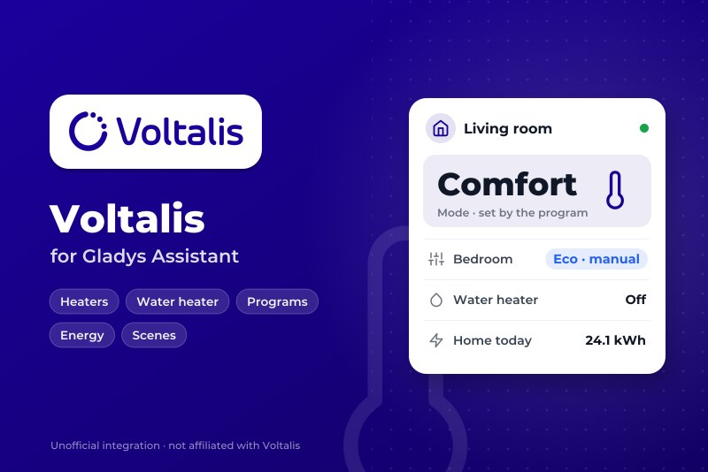
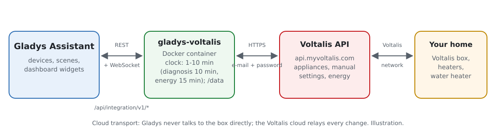
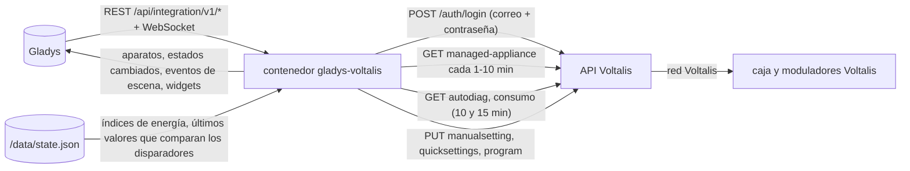
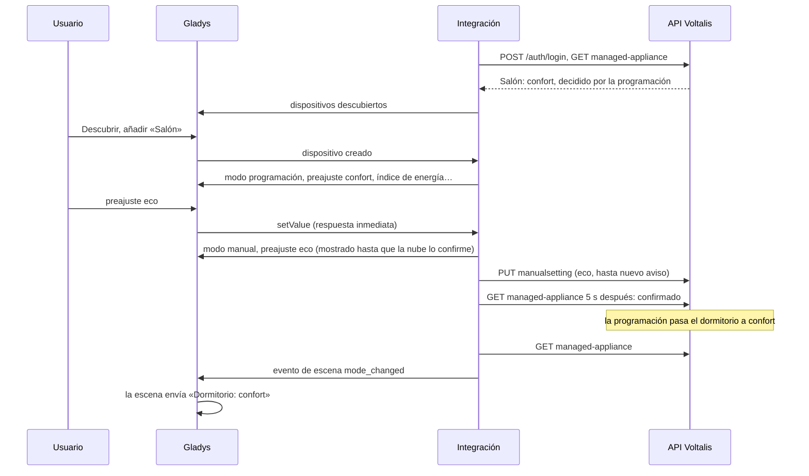
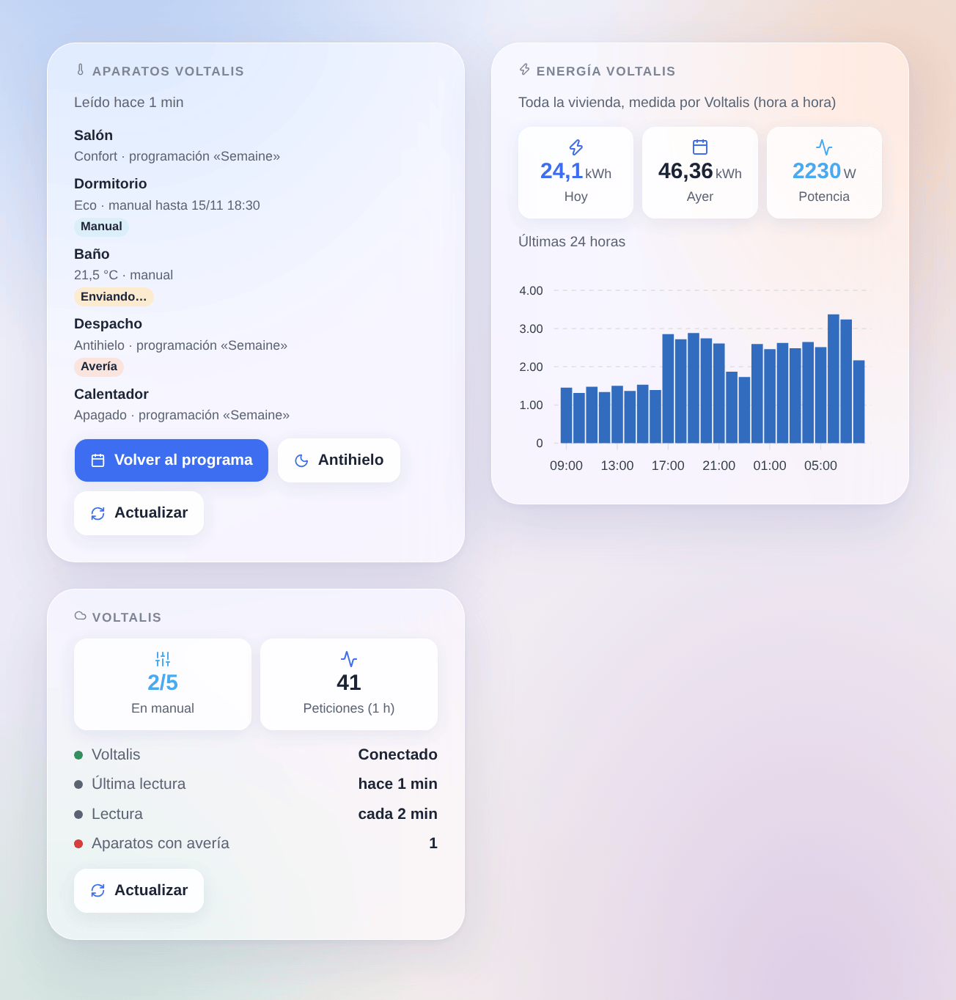

# Gladys Voltalis

[English](README.md) · [Français](README.fr.md) · [Deutsch](README.de.md) · **Español**

[](LICENSE)
[](https://github.com/William-De71/gladys-voltalis/releases)
[](https://github.com/William-De71/gladys-voltalis/actions/workflows/release.yml)
[](https://gladysassistant.com)



Integración externa de [Gladys Assistant](https://gladysassistant.com) para la caja **Voltalis**: un dispositivo por aparato (radiadores con hilo piloto, calentador de agua, otras cargas) con su modo, su preajuste, su consigna y su índice de energía, y un dispositivo para la vivienda con su potencia y su energía. Inicia sesión con su cuenta MyVoltalis, añade disparadores y acciones de escena, y widgets para los aparatos y la energía de las últimas 24 horas.

Documentación de usuario: [English](docs/en.md) · [Français](docs/fr.md) · [Deutsch](docs/de.md) · [Español](docs/es.md).

Sin relación con Voltalis. Voltalis **no publica documentación** del servicio de su app: las peticiones son las que usan las integraciones comunitarias para Home Assistant ([voltalis-homeassistant](https://github.com/ppaglier/voltalis-homeassistant), [ha-voltalis](https://github.com/jdelahayes/ha-voltalis)), y pueden cambiar sin previo aviso. **Aún no probada con una caja Voltalis real**: cuéntenos qué funciona y qué no.

## Funciones

- **Un dispositivo por aparato**: modo (apagado, manual, programación), preajuste (antihielo, eco, confort) para los radiadores, consigna (de 7 a 30 °C por medios grados) cuando el aparato la admite, y un **índice de energía** para el panel de energía de Gladys.
- **Un dispositivo para la vivienda**: potencia actual e índice de energía, tal como los mide Voltalis.
- Todos los aparatos leídos en **una sola petición** cada 1, 2, 5 o 10 minutos; el autodiagnóstico y la potencia cada 10 minutos, la energía cada 15 minutos. Las órdenes se muestran al instante y se confirman en la siguiente lectura.
- **3 disparadores de escena**, **4 acciones de escena** y **3 widgets** (abajo), un botón **Probar la conexión**.
- Cuatro idiomas en todas partes: inglés, francés, alemán, español.

## Funcionamiento





De un preajuste a una escena:



### Transporte

`transports: ["cloud"]`: cada petición va a `api.myvoltalis.com` con el correo y la contraseña de su cuenta MyVoltalis; la nube de Voltalis transmite los cambios a la caja. La caja no ofrece acceso local. `/data` guarda el índice de energía de cada aparato y de la vivienda, la energía de las últimas 48 horas y los últimos valores que comparan los disparadores.

## Dispositivos y funciones

| Dispositivo | Función   | Categoría / tipo                    | Unidad / valores                | Modificable |
| ----------- | --------- | ----------------------------------- | ------------------------------- | ----------- |
| Aparato     | Modo      | `thermostat` / `mode`               | apagado / manual / programación | sí          |
| Aparato     | Preajuste | `thermostat` / `preset`             | antihielo, eco, confort         | sí          |
| Aparato     | Consigna  | `thermostat` / `target-temperature` | °C, de 7 a 30 por 0,5           | sí          |
| Aparato     | Energía   | `energy-sensor` / `index`           | kWh (acumulado)                 | no          |
| Vivienda    | Potencia  | `energy-sensor` / `power`           | W                               | no          |
| Vivienda    | Energía   | `energy-sensor` / `index`           | kWh (acumulado)                 | no          |

El preajuste existe para los aparatos que tienen esos modos (radiadores con hilo piloto), la consigna para aquellos a los que MyVoltalis ofrece el modo «temperatura»; un calentador de agua u otra carga con relé solo tiene el modo y la energía. Escribir un preajuste o una consigna crea un **ajuste manual** hasta nuevo aviso, como hace la app; «programación» lo termina. Voltalis da la energía hora a hora: la integración suma lo nuevo de cada hora a un índice guardado en `/data`.

## Disparadores, acciones de escena y widgets



Widgets:

- **Aparatos Voltalis**: lo que hace cada aparato, quién lo decidió (la programación o un ajuste manual, y hasta cuándo), una insignia (manual, avería, orden enviándose), el detalle al tocar, **Volver al programa** y **Antihielo** para los aparatos del widget, **Actualizar**. Ajustes: los aparatos que mostrar (8 como máximo).
- **Energía Voltalis**: energía de hoy y de ayer, potencia actual, gráfico de barras de las últimas 24 horas. Ajustes: los aparatos que contar (vacío: toda la vivienda).
- **Voltalis**: conexión, aparatos en modo manual, aparatos con avería, peticiones de la última hora, **Actualizar**.

Disparadores de escena (cada uno filtrable por aparato): cambia el modo de un aparato (por la programación o en la app MyVoltalis, nunca por la propia Gladys; filtrable también por nuevo modo), un aparato entra en avería (autodiagnóstico de Voltalis), un aparato vuelve a la normalidad.

Acciones de escena: poner un modo manual (confort, eco, antihielo, una temperatura, encendido, apagado) durante un tiempo o hasta nuevo aviso, para un aparato o todos los que tienen ese modo; volver a la programación; activar o desactivar un ajuste rápido de MyVoltalis (en casa, ausencia corta o larga) o uno de sus programas; leer los aparatos ahora.

Ejemplos:

- Cuando todos salen de casa → poner todos los radiadores en antihielo; cuando alguien vuelve → volver a la programación.
- Cuando se abre una ventana del salón → apagar su radiador durante 1 hora.
- Cuando un aparato entra en avería → notificar «{{triggerEvent.data.device_name}}: {{triggerEvent.data.status}}».

## Requisitos

- Gladys Assistant **5.3.0** o posterior (las instancias más antiguas no pueden instalarla).
- Una caja Voltalis instalada en casa (Voltalis solo equipa viviendas en Francia) y una cuenta MyVoltalis: el correo y la contraseña de la app o de [myvoltalis.com](https://myvoltalis.com).

## Instalación

- **Desde la tienda**: Integraciones → Voltalis → Instalar.
- **Desde la URL del repositorio**: Integraciones → integración externa → `https://github.com/William-De71/gladys-voltalis`.
- **Modo desarrollador**: ejecute `npm start` con las variables que da Gladys (vea Desarrollo).

## Configuración

| Campo o botón                            | Por defecto | Significado                                                       |
| ---------------------------------------- | ----------- | ----------------------------------------------------------------- |
| Correo electrónico                       | —           | Obligatorio, el correo de la cuenta MyVoltalis                    |
| Contraseña                               | —           | Obligatoria, un secreto: nunca se vuelve a mostrar ni se registra |
| Intervalo de lectura                     | 2 min       | 1, 2, 5 o 10 minutos; una petición para todos los aparatos        |
| Idioma de los textos de los dispositivos | automático  | Nombres de las funciones y mensajes del botón                     |
| Probar la conexión                       | —           | Lee los aparatos ahora y los lista con su tipo y funciones        |

## Uso

1. Introduzca el correo y la contraseña y pulse **Probar la conexión** (Integraciones → Voltalis → Configuración).
2. **Descubrir** y añada los aparatos que quiera y el dispositivo «Vivienda Voltalis».
3. Añada los widgets **Aparatos Voltalis** y **Energía Voltalis** a un panel.
4. Cree escenas con las funciones de los dispositivos, los disparadores y las acciones.

## Desarrollo

```bash
npm install
npm test                       # node --test, nunca toca la red
npm run lint                   # ESLint
npm run format:check           # Prettier
npx github:GladysAssistant/integration-store . --skip-image-check
scripts/build-cover.sh         # cover.jpg desde docs/assets/cover.svg
docs/illustrations/render.sh   # docs/assets/widgets.<lang>.png
```

En local, el SDK lee `GLADYS_HOST_API_URL`, `GLADYS_INTEGRATION_TOKEN` y `GLADYS_INTEGRATION_SELECTOR` (los da Gladys en modo desarrollador), y la integración lee `TZ` (el idioma supuesto, y los días cuando Voltalis no da zona horaria). `DEBUG=gladys-integration-sdk` muestra los registros del SDK.

Las pruebas cubren el cliente de la API (sesión, renovación del token, espaciado, credenciales incorrectas, 401 / 429 / 500, API inaccesible), el modelo de datos (modos, ajustes manuales, límites de consigna, horas contadas una sola vez, valores anómalos), los dispositivos (los campos que exige la pantalla Descubrir, los pares categoría / tipo), los disparadores de escena, los widgets (`validateWidgetContent`), el manifiesto, los cuatro idiomas, el script de release y la integración completa frente al Gladys falso del SDK y una API falsa (valores ordenados, rechazos, ralentización, programas, reinicio). `test/structure.test.js` congela todas las claves que guardan los usuarios.

## Proceso de release


Cada fusión en `main` ejecuta la CI y luego calcula la versión a partir de los [Conventional Commits](https://www.conventionalcommits.org/) desde la última etiqueta: `feat` → menor, `fix` / `perf` → parche, `!` o `BREAKING CHANGE` → mayor (menor por debajo de 1.0.0); `docs`, `chore`, `ci`, `test`, `style`, `refactor`, `build` solos no publican nada. Se genera la sección del changelog, se envía la etiqueta, se construye la imagen multiarquitectura, luego `main` recibe el commit de release, se crea la GitHub Release y un último job comprueba la imagen pública, el validador de la tienda y el topic.

- El título de la pull request pasa a ser el commit de fusión y luego la línea del changelog: escríbalo en inglés, para el usuario (`pr-title.yml` lo comprueba). Nunca edite `CHANGELOG.md` a mano.
- La 1.0.0 es una decisión: Actions → Release → Run workflow con `release-as: 1.0.0`. `dry-run` muestra la versión y las notas sin publicar.
- **Rama protegida**: la release envía su commit a `main` con `GITHUB_TOKEN`. El ruleset `protect-main` (sin borrado ni force-push) lo deja pasar; una regla más estricta (pull request obligatoria, status checks) necesitaría GitHub Actions en su lista de excepciones, o una GitHub App.
- Tras la primera release, haga público el paquete de `ghcr.io` (Package settings → Change visibility), o Gladys no podrá descargarlo.

## Solución de problemas

Vea [docs/es.md](docs/es.md#solución-de-problemas). Informe de los problemas con las versiones de Gladys y de la integración, sus aparatos, el resultado de «Probar la conexión» y los registros de la integración. Nunca pegue su correo ni su contraseña.

## Contribuir

Las issues y las pull requests son bienvenidas. Ejecute `npm run format:check && npm run lint && npm test` antes de abrir una pull request, y mantenga sin cambios todos los id externos y las claves guardadas (vea [CLAUDE.md](CLAUDE.md)).

## Seguridad

Vea [SECURITY.md](SECURITY.md): informe de las vulnerabilidades en privado. La contraseña es un campo `secret`: nunca se registra, nunca se escribe en `/data`, solo se envía a `api.myvoltalis.com` por HTTPS para abrir una sesión; ni el token ni la contraseña aparecen en un mensaje de error. Voltalis no ofrece un acceso separado para terceros: la integración guarda la contraseña de su cuenta, cámbiela en MyVoltalis para revocar el acceso.

## Capturas pendientes

Las imágenes de arriba son ilustraciones, no capturas de pantalla. Las capturas reales irán en `docs/assets/screenshots/` (PNG, 1280 × 800): `configuration.png` (credenciales y «Probar la conexión»), `discovery.png`, `device.png` (un radiador), `scene.png`.

## Licencia

[Licencia Apache 2.0](LICENSE) — vea también [NOTICE](NOTICE). Voltalis y MyVoltalis son marcas de Voltalis SA. Los datos de la API proceden de [voltalis-homeassistant](https://github.com/ppaglier/voltalis-homeassistant) de ppaglier, de [ha-voltalis](https://github.com/jdelahayes/ha-voltalis) de Johann Delahayes y del puente Voltalis de [ha-addons](https://github.com/zaosoula/ha-addons) de Zao Soula (todos MIT), citados en NOTICE; no se ha copiado código. Gracias a la documentación y al SDK de Gladys.
