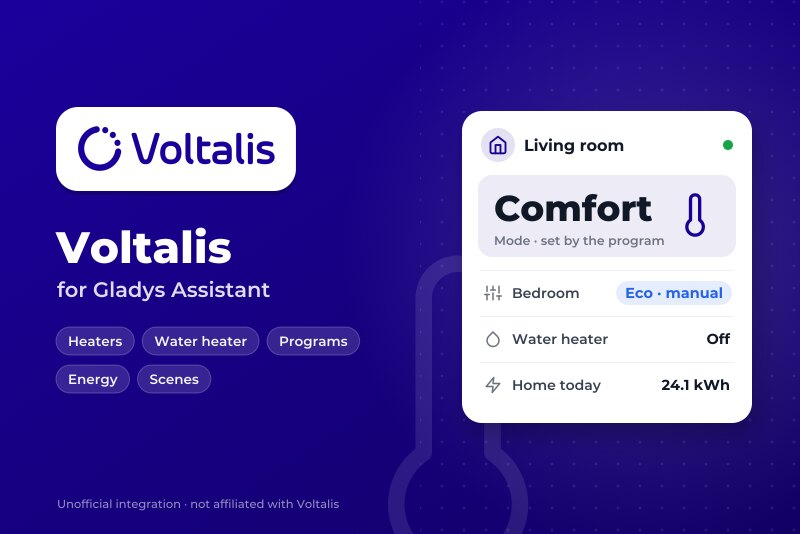
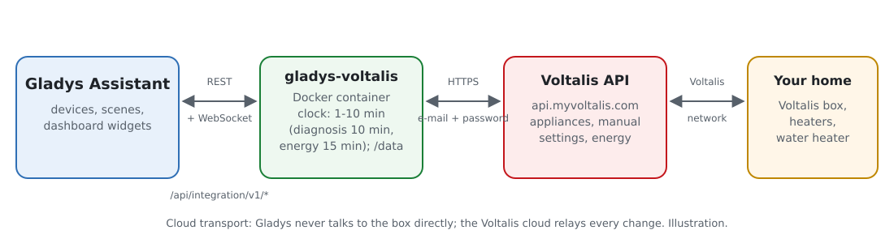
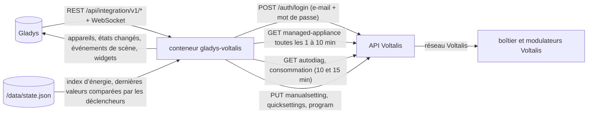
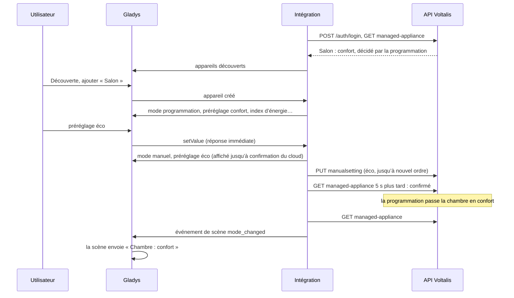
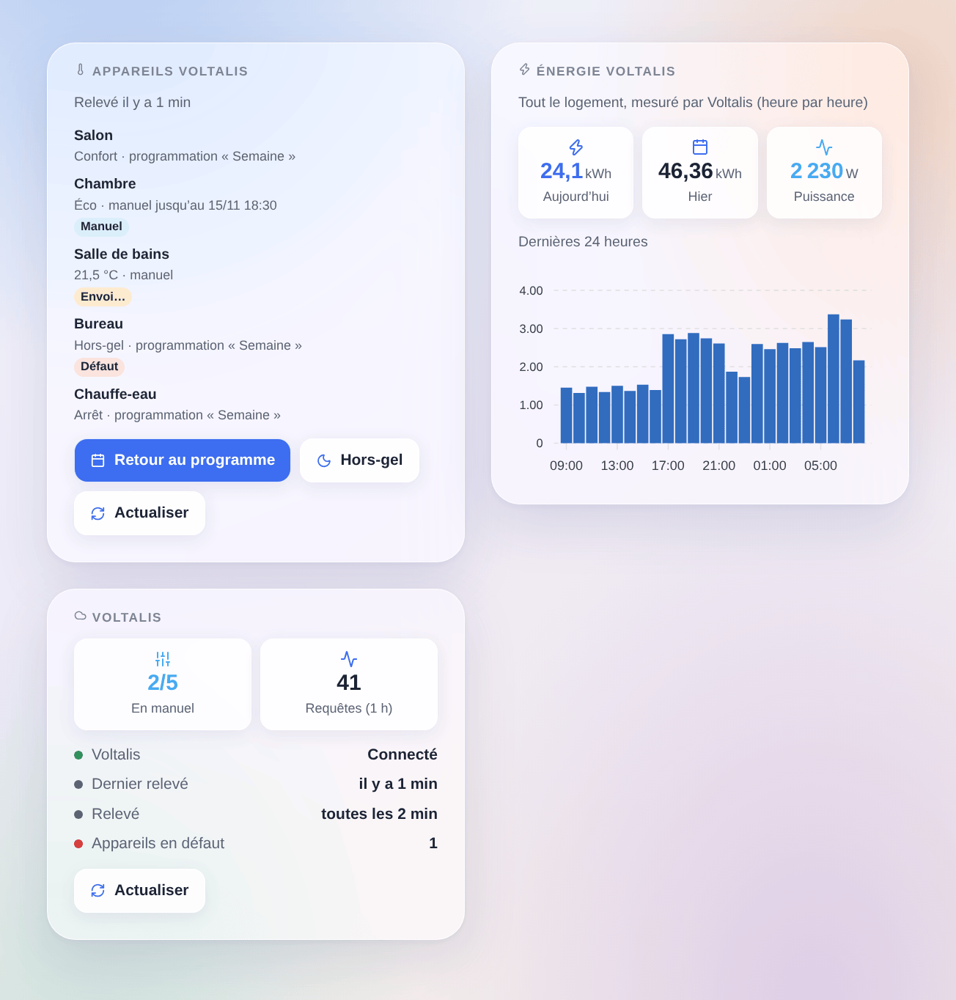

# Gladys Voltalis

[English](README.md) · **Français** · [Deutsch](README.de.md) · [Español](README.es.md)

[](LICENSE)
[](https://github.com/William-De71/gladys-voltalis/releases)
[](https://github.com/William-De71/gladys-voltalis/actions/workflows/release.yml)
[](https://gladysassistant.com)



Intégration externe [Gladys Assistant](https://gladysassistant.com) pour le boîtier **Voltalis** : un appareil par équipement (radiateurs sur fil pilote, chauffe-eau, autres charges) avec son mode, son préréglage, sa consigne et son index d’énergie, et un appareil pour le logement avec sa puissance et son énergie. Elle se connecte avec votre compte MyVoltalis, ajoute des déclencheurs et des actions de scène, et des widgets pour les appareils et l’énergie des dernières 24 heures.

Documentation utilisateur : [English](docs/en.md) · [Français](docs/fr.md) · [Deutsch](docs/de.md) · [Español](docs/es.md).

Sans lien avec Voltalis. Voltalis ne publie **aucune documentation** du service de son application : les requêtes sont celles qu’utilisent les intégrations communautaires pour Home Assistant ([voltalis-homeassistant](https://github.com/ppaglier/voltalis-homeassistant), [ha-voltalis](https://github.com/jdelahayes/ha-voltalis)), et elles peuvent changer sans préavis. **Pas encore testée sur un vrai boîtier Voltalis** : dites-nous ce qui marche et ce qui ne marche pas.

## Fonctionnalités

- **Un appareil par équipement** : mode (arrêt, manuel, programmation), préréglage (hors-gel, éco, confort) pour les radiateurs, consigne (de 7 à 30 °C par demi-degré) quand l’équipement en accepte une, et un **index d’énergie** pour le tableau de bord énergie de Gladys.
- **Un appareil pour le logement** : puissance actuelle et index d’énergie, tels que Voltalis les mesure.
- Tous les appareils relevés en **une seule requête** toutes les 1, 2, 5 ou 10 minutes ; l’autodiagnostic et la puissance toutes les 10 minutes, l’énergie toutes les 15 minutes. Les commandes s’affichent aussitôt et sont confirmées au relevé suivant.
- **3 déclencheurs de scène**, **4 actions de scène** et **3 widgets** (ci-dessous), un bouton **Tester la connexion**.
- Quatre langues partout : anglais, français, allemand, espagnol.

## Fonctionnement





D’un préréglage à une scène :



### Transport

`transports: ["cloud"]` : chaque requête part vers `api.myvoltalis.com` avec l’e-mail et le mot de passe de votre compte MyVoltalis ; le cloud Voltalis relaie les changements au boîtier. Le boîtier n’offre aucun accès local. `/data` garde l’index d’énergie de chaque appareil et du logement, l’énergie des dernières 48 heures et les dernières valeurs que comparent les déclencheurs.

## Appareils et fonctionnalités

| Appareil   | Fonctionnalité | Catégorie / type                    | Unité / valeurs                | Modifiable |
| ---------- | -------------- | ----------------------------------- | ------------------------------ | ---------- |
| Équipement | Mode           | `thermostat` / `mode`               | arrêt / manuel / programmation | oui        |
| Équipement | Préréglage     | `thermostat` / `preset`             | hors-gel, éco, confort         | oui        |
| Équipement | Consigne       | `thermostat` / `target-temperature` | °C, de 7 à 30 par 0,5          | oui        |
| Équipement | Énergie        | `energy-sensor` / `index`           | kWh (cumulé)                   | non        |
| Logement   | Puissance      | `energy-sensor` / `power`           | W                              | non        |
| Logement   | Énergie        | `energy-sensor` / `index`           | kWh (cumulé)                   | non        |

Le préréglage existe pour les équipements qui ont ces modes (radiateurs sur fil pilote), la consigne pour ceux auxquels MyVoltalis propose le mode « température » ; un chauffe-eau ou une autre charge sur relais n’a que le mode et l’énergie. Écrire un préréglage ou une consigne crée un **réglage manuel** jusqu’à nouvel ordre, comme le fait l’application ; « programmation » y met fin. Voltalis donne l’énergie heure par heure : l’intégration ajoute ce qui est nouveau de chaque heure à un index gardé dans `/data`.

## Déclencheurs, actions de scène et widgets



Widgets :

- **Appareils Voltalis** : ce que fait chaque appareil, qui l’a décidé (la programmation ou un réglage manuel, et jusqu’à quand), un badge (manuel, défaut, commande en cours d’envoi), le détail au toucher, **Retour au programme** et **Hors-gel** pour les appareils du widget, **Actualiser**. Réglages : les appareils à afficher (8 au plus).
- **Énergie Voltalis** : énergie d’aujourd’hui et d’hier, puissance actuelle, graphique en barres des dernières 24 heures. Réglages : les appareils à compter (vide : tout le logement).
- **Voltalis** : connexion, appareils en mode manuel, appareils en défaut, requêtes de la dernière heure, **Actualiser**.

Déclencheurs de scène (chacun filtrable par appareil) : le mode d’un appareil change (par la programmation ou dans l’application MyVoltalis, jamais par Gladys elle-même ; filtrable aussi par nouveau mode), un appareil passe en défaut (autodiagnostic Voltalis), un appareil revient à la normale.

Actions de scène : passer en mode manuel (confort, éco, hors-gel, une température, marche, arrêt) pour une durée ou jusqu’à nouvel ordre, pour un appareil ou tous ceux qui ont ce mode ; revenir à la programmation ; activer ou désactiver un réglage rapide de MyVoltalis (à la maison, absence courte ou longue) ou l’un de vos programmes ; relever les appareils maintenant.

Exemples :

- Quand tout le monde quitte la maison → passer tous les radiateurs en hors-gel ; quand quelqu’un rentre → revenir à la programmation.
- Quand une fenêtre du salon s’ouvre → arrêter son radiateur pendant 1 heure.
- Quand un appareil passe en défaut → notifier « {{triggerEvent.data.device_name}} : {{triggerEvent.data.status}} ».

## Prérequis

- Gladys Assistant **5.3.0** ou plus récent (les instances plus anciennes ne peuvent pas l’installer).
- Un boîtier Voltalis installé chez vous (Voltalis n’équipe que des logements en France), et un compte MyVoltalis : l’e-mail et le mot de passe de l’application ou de [myvoltalis.com](https://myvoltalis.com).

## Installation

- **Depuis le store** : Intégrations → Voltalis → Installer.
- **Depuis l’URL du dépôt** : Intégrations → intégration externe → `https://github.com/William-De71/gladys-voltalis`.
- **Mode développeur** : lancez `npm start` avec les variables données par Gladys (voir Développement).

## Configuration

| Champ ou bouton                 | Défaut      | Rôle                                                                           |
| ------------------------------- | ----------- | ------------------------------------------------------------------------------ |
| E-mail                          | —           | Obligatoire, l’e-mail du compte MyVoltalis                                     |
| Mot de passe                    | —           | Obligatoire, un secret : jamais réaffiché, jamais journalisé                   |
| Intervalle de relevé            | 2 min       | 1, 2, 5 ou 10 minutes ; une requête pour tous les appareils                    |
| Langue des textes des appareils | automatique | Noms des fonctionnalités et messages du bouton                                 |
| Tester la connexion             | —           | Relève les appareils maintenant et les liste avec leur type et fonctionnalités |

## Utilisation

1. Saisissez l’e-mail et le mot de passe, puis appuyez sur **Tester la connexion** (Intégrations → Voltalis → Configuration).
2. **Découverte**, puis ajoutez les appareils voulus et l’appareil « Logement Voltalis ».
3. Ajoutez les widgets **Appareils Voltalis** et **Énergie Voltalis** à un tableau de bord.
4. Construisez vos scènes avec les fonctionnalités des appareils, les déclencheurs et les actions.

## Développement

```bash
npm install
npm test                       # node --test, ne touche jamais le réseau
npm run lint                   # ESLint
npm run format:check           # Prettier
npx github:GladysAssistant/integration-store . --skip-image-check
scripts/build-cover.sh         # cover.jpg depuis docs/assets/cover.svg
docs/illustrations/render.sh   # docs/assets/widgets.<lang>.png
```

En local, le SDK lit `GLADYS_HOST_API_URL`, `GLADYS_INTEGRATION_TOKEN` et `GLADYS_INTEGRATION_SELECTOR` (donnés par Gladys en mode développeur), et l’intégration lit `TZ` (la langue devinée, et les jours quand Voltalis ne donne pas de fuseau). `DEBUG=gladys-integration-sdk` affiche les journaux du SDK.

Les tests couvrent le client d’API (session, renouvellement du jeton, espacement, mauvais identifiants, 401 / 429 / 500, API injoignable), le modèle de données (modes, réglages manuels, bornes de consigne, heures comptées une seule fois, valeurs aberrantes), les appareils (les champs qu’exige l’écran Découverte, les couples catégorie / type), les déclencheurs de scène, les widgets (`validateWidgetContent`), le manifeste, les quatre langues, le script de release, et l’intégration entière face au faux Gladys du SDK et à une fausse API (valeurs commandées, refus, ralentissement, programmes, redémarrage). `test/structure.test.js` fige toutes les clés que les utilisateurs stockent.

## Processus de release


Chaque fusion sur `main` lance la CI, puis calcule la version d’après les [Conventional Commits](https://www.conventionalcommits.org/) depuis le dernier tag : `feat` → mineure, `fix` / `perf` → correctif, `!` ou `BREAKING CHANGE` → majeure (mineure tant que la version est sous 1.0.0) ; `docs`, `chore`, `ci`, `test`, `style`, `refactor`, `build` seuls ne publient rien. La section du changelog est générée, le tag poussé, l’image multi-architecture construite, puis `main` reçoit le commit de release, la GitHub Release est créée et un dernier job vérifie l’image publique, le validateur du store et le topic.

- Le titre de la pull request devient le commit de fusion, puis la ligne du changelog : écrivez-le en anglais, pour l’utilisateur (`pr-title.yml` le vérifie). Ne modifiez jamais `CHANGELOG.md` à la main.
- La 1.0.0 est une décision : Actions → Release → Run workflow avec `release-as: 1.0.0`. `dry-run` affiche la version et les notes sans rien publier.
- **Branche protégée** : des rulesets imposent une pull request sur `main` et verrouillent les tags `v*` ; seuls le mainteneur et les deploy keys passent. La release pousse avec la deploy key de l’environnement `release` (secret `RELEASE_DEPLOY_KEY`, `main` seulement) : un run lancé depuis une autre branche ne l’obtient jamais. `build.yml` et `github-release.yml` ne démarrent pas sur un tag : la release les appelle, ou lancez-les à la main (Actions → Run workflow, avec `version` pour l’image) pour terminer une release.
- Après la première release, rendez le package `ghcr.io` public (Package settings → Change visibility), sinon Gladys ne peut pas le télécharger.

## Dépannage

Voir [docs/fr.md](docs/fr.md#dépannage). Signalez un problème avec les versions de Gladys et de l’intégration, vos appareils, le résultat de « Tester la connexion » et les journaux de l’intégration. Ne collez jamais votre e-mail ni votre mot de passe.

## Contribuer

Les issues et les pull requests sont bienvenues. Lancez `npm run format:check && npm run lint && npm test` avant d’ouvrir une pull request, et gardez tous les identifiants externes et les clés stockées inchangés (voir [CLAUDE.md](CLAUDE.md)).

## Sécurité

Voir [SECURITY.md](SECURITY.md) : signalez les failles en privé. Le mot de passe est un champ `secret` : jamais journalisé, jamais écrit dans `/data`, envoyé seulement à `api.myvoltalis.com` en HTTPS pour ouvrir une session ; ni le jeton ni le mot de passe n’apparaissent dans un message d’erreur. Voltalis ne propose pas d’accès séparé pour les tiers : l’intégration détient le mot de passe de votre compte, changez-le dans MyVoltalis pour révoquer l’accès.

## Captures d’écran à venir

Les images ci-dessus sont des illustrations, pas des captures d’écran. Les vraies captures iront dans `docs/assets/screenshots/` (PNG, 1280 × 800) : `configuration.png` (identifiants et « Tester la connexion »), `discovery.png`, `device.png` (un radiateur), `scene.png`.

## Licence

[Licence Apache 2.0](LICENSE) — voir aussi [NOTICE](NOTICE). Voltalis et MyVoltalis sont des marques de Voltalis SA. Les faits d’API viennent de [voltalis-homeassistant](https://github.com/ppaglier/voltalis-homeassistant) de ppaglier, de [ha-voltalis](https://github.com/jdelahayes/ha-voltalis) de Johann Delahayes et de la passerelle Voltalis de [ha-addons](https://github.com/zaosoula/ha-addons) de Zao Soula (tous sous licence MIT), crédités dans NOTICE ; aucun code n’a été copié. Merci à la documentation et au SDK de Gladys.
