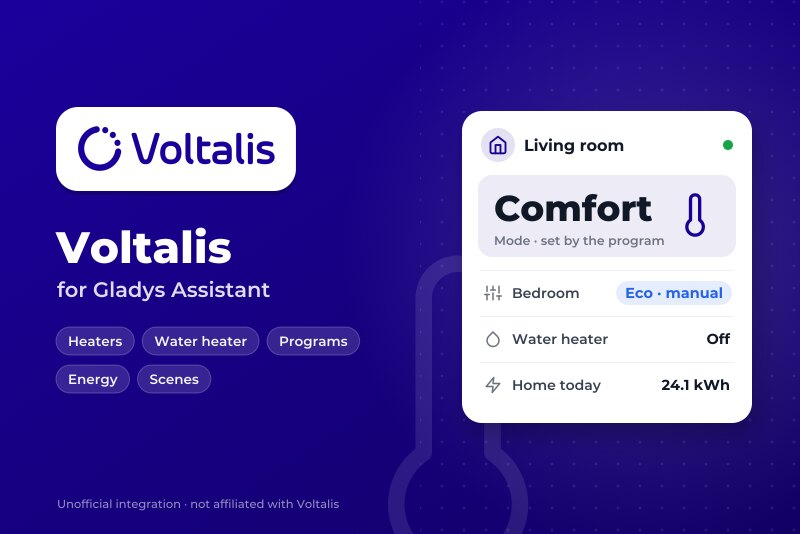
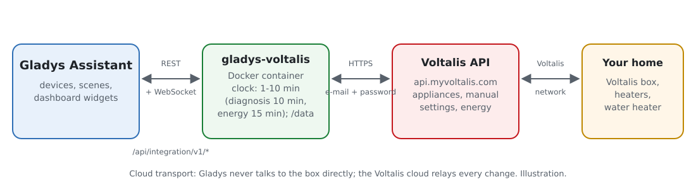
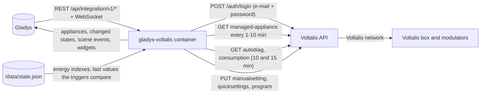
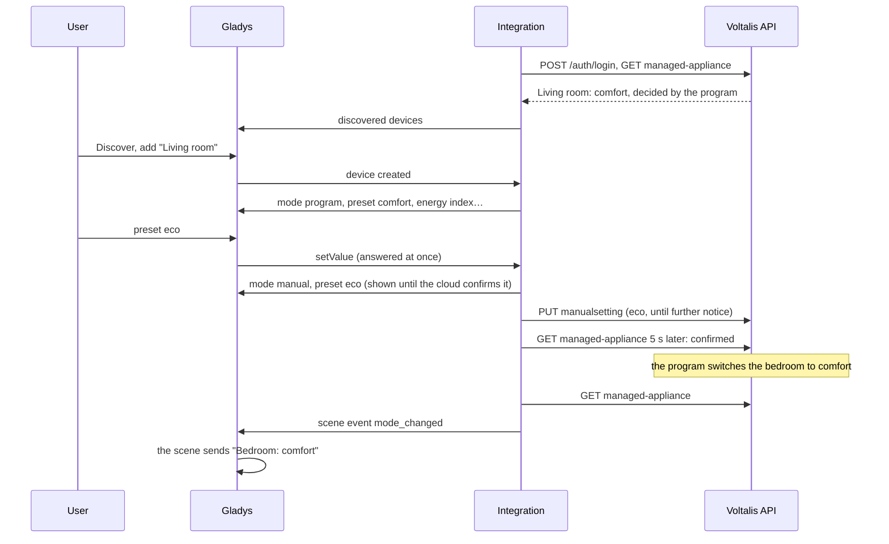
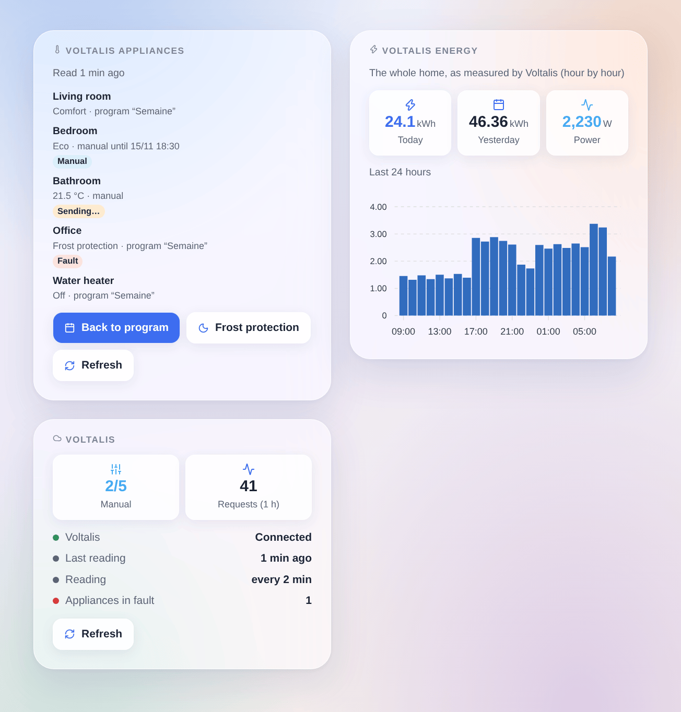

# Gladys Voltalis

**English** · [Français](README.fr.md) · [Deutsch](README.de.md) · [Español](README.es.md)

[](LICENSE)
[](https://github.com/William-De71/gladys-voltalis/releases)
[](https://github.com/William-De71/gladys-voltalis/actions/workflows/release.yml)
[](https://gladysassistant.com)



[Gladys Assistant](https://gladysassistant.com) external integration for the **Voltalis** box: one device per appliance (heaters on their pilot wire, water heater, other loads) with its mode, preset, setpoint and energy index, and one device for the home with its power and energy. It signs in with your MyVoltalis account, adds scene triggers and actions, and widgets for the appliances and the energy of the last 24 hours.

User documentation: [English](docs/en.md) · [Français](docs/fr.md) · [Deutsch](docs/de.md) · [Español](docs/es.md).

Not affiliated with Voltalis. Voltalis publishes **no documentation** for the service behind its app: the requests are the ones the community integrations for Home Assistant use ([voltalis-homeassistant](https://github.com/ppaglier/voltalis-homeassistant), [ha-voltalis](https://github.com/jdelahayes/ha-voltalis)), and they may change without notice. **Not tested with a real Voltalis box yet**: please report what works and what does not.

## Features

- **One device per appliance**: mode (off, manual, program), preset (frost protection, eco, comfort) for the heaters, setpoint (7 to 30 °C by half degrees) when the appliance takes one, and an **energy index** for the Gladys energy dashboard.
- **One device for the home**: power now and energy index, as Voltalis measures them.
- Every appliance read in **one request** every 1, 2, 5 or 10 minutes; the self-diagnosis and the power every 10 minutes, the energy every 15 minutes. Commands shown at once and confirmed by the next reading.
- **3 scene triggers**, **4 scene actions** and **3 dashboard widgets** (below), a **Test the connection** button.
- Four languages everywhere: English, French, German, Spanish.

## How it works





From a preset to a scene:



### Transport

`transports: ["cloud"]`: every request goes to `api.myvoltalis.com` with your MyVoltalis e-mail and password; the Voltalis cloud relays the changes to the box. The box offers no local access. `/data` keeps the energy index of each appliance and of the home, the energy of the last 48 hours and the last values the scene triggers compare.

## Devices and features

| Device    | Feature  | Category / type                     | Unit / values                  | Writable |
| --------- | -------- | ----------------------------------- | ------------------------------ | -------- |
| Appliance | Mode     | `thermostat` / `mode`               | off / manual / program         | yes      |
| Appliance | Preset   | `thermostat` / `preset`             | frost protection, eco, comfort | yes      |
| Appliance | Setpoint | `thermostat` / `target-temperature` | °C, 7–30 by 0.5                | yes      |
| Appliance | Energy   | `energy-sensor` / `index`           | kWh (cumulated)                | no       |
| Home      | Power    | `energy-sensor` / `power`           | W                              | no       |
| Home      | Energy   | `energy-sensor` / `index`           | kWh (cumulated)                | no       |

The preset exists for the appliances that have these modes (heaters on a pilot wire), the setpoint for the ones MyVoltalis offers a "temperature" mode for; a water heater or another load on a relay has the mode and the energy only. Writing a preset or a setpoint creates a **manual setting** until further notice, as the app does; "program" ends it. Voltalis gives the energy hour by hour: the integration adds what is new of each hour into an index kept in `/data`.

## Scene triggers, actions and widgets



Widgets:

- **Voltalis appliances**: what each appliance does, who decided (the program or a manual setting, and until when), a badge (manual, fault, command being sent), details on tap, **Back to program** and **Frost protection** for the appliances of the widget, **Refresh**. Settings: the appliances to show (8 at most).
- **Voltalis energy**: energy of today and yesterday, power now, bar chart of the last 24 hours. Settings: the appliances to count (empty: the whole home).
- **Voltalis**: connection, appliances in manual mode, appliances in fault, requests of the last hour, **Refresh**.

Scene triggers (each one filtered by appliance): the mode of an appliance changes (by the program or in the MyVoltalis app, never by Gladys itself; also filtered by the new mode), an appliance goes in fault (self-diagnosis of Voltalis), an appliance is back to normal.

Scene actions: set a manual mode (comfort, eco, frost protection, a temperature, on, off) for a duration or until further notice, for one appliance or every appliance that has it; go back to the program; switch a quick setting of MyVoltalis (at home, short or long absence) or one of your programs; read the appliances now.

Examples:

- When everybody leaves home → set every heater to frost protection; when somebody comes back → go back to the program.
- When a window of the living room opens → turn its heater off for 1 hour.
- When an appliance goes in fault → notify "{{triggerEvent.data.device_name}}: {{triggerEvent.data.status}}".

## Requirements

- Gladys Assistant **5.3.0** or later (older instances cannot install it).
- A Voltalis box installed at home (Voltalis only equips homes in France), and a MyVoltalis account: the e-mail and password of the app or of [myvoltalis.com](https://myvoltalis.com).

## Installation

- **From the store**: Integrations → Voltalis → Install.
- **From the repository URL**: Integrations → external integration → `https://github.com/William-De71/gladys-voltalis`.
- **Developer mode**: run `npm start` with the variables given by Gladys (see Development).

## Configuration

| Field or button              | Default   | Meaning                                                              |
| ---------------------------- | --------- | -------------------------------------------------------------------- |
| E-mail                       | —         | Required, the e-mail of the MyVoltalis account                       |
| Password                     | —         | Required, a secret: never shown again, never logged                  |
| Reading interval             | 2 min     | 1, 2, 5 or 10 minutes; one request for every appliance               |
| Language of the device texts | automatic | Feature names and button messages                                    |
| Test the connection          | —         | Reads the appliances now and lists them with their type and features |

## Usage

1. Enter the e-mail and the password, then press **Test the connection** (Integrations → Voltalis → Configuration).
2. **Discover**, then add the appliances you want and the "Voltalis home" device.
3. Add the **Voltalis appliances** and **Voltalis energy** widgets to a dashboard.
4. Build scenes with the device features, the triggers and the actions.

## Development

```bash
npm install
npm test                       # node --test, never touches the network
npm run lint                   # ESLint
npm run format:check           # Prettier
npx github:GladysAssistant/integration-store . --skip-image-check
scripts/build-cover.sh         # cover.jpg from docs/assets/cover.svg
docs/illustrations/render.sh   # docs/assets/widgets.<lang>.png
```

Locally, the SDK reads `GLADYS_HOST_API_URL`, `GLADYS_INTEGRATION_TOKEN` and `GLADYS_INTEGRATION_SELECTOR` (given by Gladys in developer mode), and the integration reads `TZ` (the language guess, and the days when Voltalis gives no timezone). `DEBUG=gladys-integration-sdk` shows the SDK logs.

The tests cover the API client (session, token renewal, spacing, wrong credentials, 401 / 429 / 500, unreachable API), the data model (modes, manual settings, setpoint bounds, hours counted once, glitches), the devices (the fields the Discovery screen requires, category / type pairs), the scene triggers, the widgets (`validateWidgetContent`), the manifest, the four languages, the release script, and the whole integration against the fake Gladys of the SDK and a fake API (commanded values, refusals, slow-down, programs, restart). `test/structure.test.js` freezes every key users store.

## Release process


Every merge on `main` runs the CI, then computes the version from the [Conventional Commits](https://www.conventionalcommits.org/) since the last tag: `feat` → minor, `fix` / `perf` → patch, `!` or `BREAKING CHANGE` → major (a minor below 1.0.0); `docs`, `chore`, `ci`, `test`, `style`, `refactor`, `build` alone publish nothing. The changelog section is generated, the tag pushed, the multi-architecture image built, then `main` receives the release commit, the GitHub Release is created and a last job checks the public image, the store validator and the topic.

- The pull request title becomes the squash commit, then the changelog line: write it in English, for the user (`pr-title.yml` checks it). Never edit `CHANGELOG.md` by hand.
- 1.0.0 is a decision: Actions → Release → Run workflow with `release-as: 1.0.0`. `dry-run` shows the version and the notes without publishing.
- **Protected branch**: the release pushes its commit to `main` with `GITHUB_TOKEN`. The `protect-main` ruleset (no deletion, no force-push) lets it through; a stricter rule (pull request required, status checks) would need GitHub Actions in its bypass list, or a GitHub App.
- After the first release, make the `ghcr.io` package public (Package settings → Change visibility), or Gladys cannot pull it.

## Troubleshooting

See [docs/en.md](docs/en.md#troubleshooting). Report issues with the versions of Gladys and of the integration, your appliances, the result of "Test the connection" and the logs of the integration. Never paste your e-mail nor your password.

## Contributing

Issues and pull requests are welcome. Run `npm run format:check && npm run lint && npm test` before opening a pull request, and keep every external id and stored key unchanged (see [CLAUDE.md](CLAUDE.md)).

## Security

See [SECURITY.md](SECURITY.md): report vulnerabilities privately. The password is a `secret` field: never logged, never written to `/data`, sent only to `api.myvoltalis.com` over HTTPS to open a session; neither the token nor the password appears in an error message. Voltalis offers no separate access for third parties: the integration holds the password of your account, so change it in MyVoltalis to revoke the access.

## Screenshots to come

The images above are illustrations, not screenshots. Real screenshots will go in `docs/assets/screenshots/` (PNG, 1280 × 800): `configuration.png` (credentials and "Test the connection"), `discovery.png`, `device.png` (a heater), `scene.png`.

## License

[Apache License 2.0](LICENSE) — see also [NOTICE](NOTICE). Voltalis and MyVoltalis are trademarks of Voltalis SA. The API facts come from [voltalis-homeassistant](https://github.com/ppaglier/voltalis-homeassistant) by ppaglier, [ha-voltalis](https://github.com/jdelahayes/ha-voltalis) by Johann Delahayes and the Voltalis bridge of [ha-addons](https://github.com/zaosoula/ha-addons) by Zao Soula (all MIT), credited in NOTICE; no code was copied. Thanks to the Gladys documentation and SDK.
