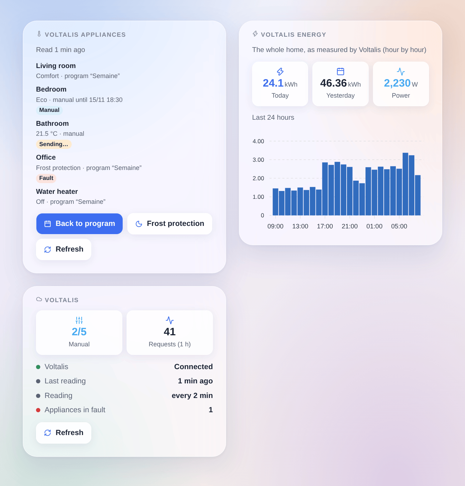

# Voltalis

## Overview

This integration brings the appliances behind your **Voltalis** box into Gladys: heaters on their pilot wire, water heater, other loads. It signs in with the e-mail and the password of your **MyVoltalis** account, as the app does.

- One Gladys device per **appliance**: mode (off, manual, program), preset (frost protection, eco, comfort), setpoint when the appliance takes one, and an energy index for the Gladys energy dashboard.
- One device for the **home**: power now and energy index.
- Scene triggers (the mode of an appliance changes, an appliance goes in fault or recovers) and scene actions (manual mode for a duration, back to the program, programs and quick settings, read now).
- Three dashboard widgets: the appliances, with "Back to program" and "Frost protection" buttons, the energy of today and of the last 24 hours, and the connection.

**Transport: cloud.** Gladys never talks to your box directly: it reads and writes the Voltalis cloud, which relays the changes. A change made in Gladys is shown at once and confirmed a few seconds later; a change made in the MyVoltalis app or by a program reaches Gladys at the next reading. Your data leave your home (they already do with the Voltalis box).

Not affiliated with Voltalis. The service used is the one behind the MyVoltalis app; Voltalis **does not document it** and may change it without notice. Not yet tested with a real Voltalis box: please report what works and what does not.

## Prerequisites

- Gladys Assistant **5.3.0** or later.
- A **Voltalis box** installed at home (Voltalis only equips homes in France).
- A **MyVoltalis account**: check that you can sign in to the app or to myvoltalis.com with your e-mail and password. Voltalis offers no separate access for third parties: the integration uses the password of your account.

## Configuration

In Gladys, open **Integrations → Voltalis**:

| Field                        | Description                                                                    |
| ---------------------------- | ------------------------------------------------------------------------------ |
| E-mail                       | The e-mail of your MyVoltalis account.                                         |
| Password                     | Its password: sent to Voltalis only, never shown again or logged.              |
| Reading interval             | Every 1, 2, 5 or 10 minutes (2 by default). One request reads every appliance. |
| Language of the device texts | Names of the features and messages of the button; automatic by default.        |

Click **Test the connection**: the integration reads your appliances and lists them with their type and features. Then open the **Discover** tab and add the appliances you want, and the "Voltalis home" device: nothing is created without you. With several homes on the account, only the default one of MyVoltalis is read.

## Usage

### Devices

Each appliance offers these features, according to what MyVoltalis offers for it:

| Feature  | Gladys type                                       | Notes                                                                                                                   |
| -------- | ------------------------------------------------- | ----------------------------------------------------------------------------------------------------------------------- |
| Mode     | Thermostat mode: off, heating, auto               | Off: a manual stop. Heating: a manual setting (what the appliance does stays). Auto: the appliance follows its program. |
| Preset   | Thermostat preset: frost protection, eco, comfort | Heaters only. Choosing one creates a manual setting until further notice.                                               |
| Setpoint | Thermostat setpoint, 7 to 30 °C by 0.5 °C         | Only when MyVoltalis offers the "temperature" mode. Changing it creates a manual setting in temperature mode.           |
| Energy   | Energy index (kWh)                                | Counted by the integration from the hours Voltalis measures; feeds the consumption and cost pages of Gladys.            |

The **Voltalis home** device offers the power now (the last 10 minutes measured by Voltalis) and an energy index for the whole home.

Voltalis gives the energy **hour by hour**, with some delay: the index moves a few times per hour, not continuously. It starts with the hours of the day the device is first read: Gladys only uses its increases. A box does not measure room temperatures: there is no temperature sensor.

### Dashboard widgets

- **Voltalis appliances**: each appliance with what it does and who decided (the program, or a manual setting and its end), a badge (manual, fault, a command being sent). Tap an appliance for its details. **Back to program** ends the manual settings of the appliances of the widget, **Frost protection** sets their heaters to frost protection, both after a confirmation; **Refresh** reads now. Choose the appliances in the widget settings (8 at most).
- **Voltalis energy**: the energy of today and of yesterday, the power now, and a bar chart of the last 24 hours, for the whole home or the appliances chosen in the settings.
- **Voltalis**: the state of the connection, the appliances in manual mode, the appliances in fault, the requests of the last hour, a **Refresh** button.

### Scenes

Triggers (each one can be limited to one appliance):

- **The mode of an appliance changes**: by the Voltalis program or in the MyVoltalis app, never by Gladys itself. Can be limited to a new mode; the previous mode is a variable.
- **An appliance goes in fault** / **is back to normal**: the self-diagnosis of Voltalis (fault, no consumption seen, no communication).

Actions:

- **Set a manual mode**: comfort, eco, frost protection, a temperature, on or off, for one appliance or every appliance that has this mode, for a number of hours or until further notice (outputs: changed, refused).
- **Go back to the program**: one appliance, or every appliance in manual mode.
- **Switch a program or a quick setting**: the quick settings of MyVoltalis (at home, short absence, long absence) or one of your programs, by its name.
- **Read the Voltalis appliances now**: outputs the appliances, the ones in manual mode, the power and the energy of today.

Examples:

- When everybody leaves home → set every heater to frost protection; when somebody comes back → go back to the program.
- When a window of the living room opens → turn its heater off for 1 hour.
- When an appliance goes in fault → send a notification "{{triggerEvent.data.device_name}}: {{triggerEvent.data.status}}".

### Transport

The catalog shows the **cloud** badge: every request goes to `api.myvoltalis.com`, with your e-mail and password. The Voltalis box offers no local access.

## Troubleshooting

- **"Voltalis refuses the credentials"**: check the e-mail and the password by signing in to the MyVoltalis app. The integration tries again every 30 minutes, or as soon as you change them.
- **Connected, but no appliance**: the account has no appliance on its default home; check MyVoltalis.
- **No preset or no setpoint on an appliance**: MyVoltalis does not offer these modes for it (a relay, or a heater without the temperature mode).
- **The energy stays empty or late**: Voltalis fills the hours with a delay; wait for an hour to end.
- **A command is undone after a few minutes**: Voltalis did not apply it; the dashboard goes back to what the cloud says. Check the appliance in MyVoltalis.
- **Everything stops working after an update of MyVoltalis**: the undocumented service may have changed; report it.
- Report a problem on [GitHub](https://github.com/William-De71/gladys-voltalis/issues) with your Gladys version, the integration version and the result of "Test the connection".
